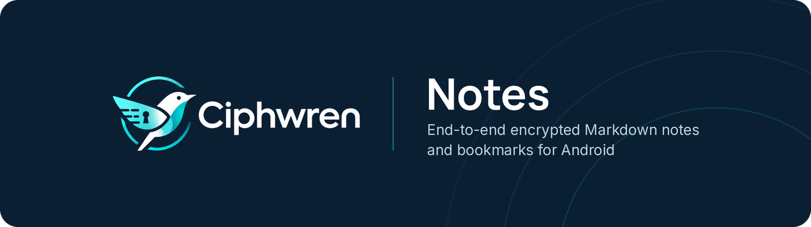
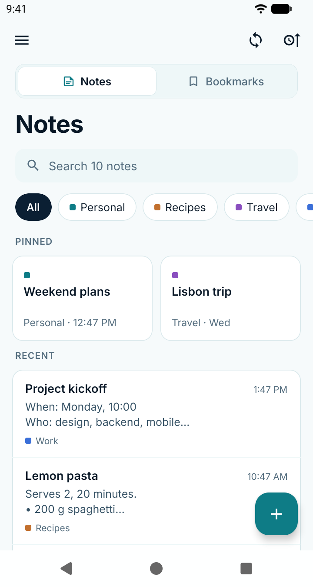
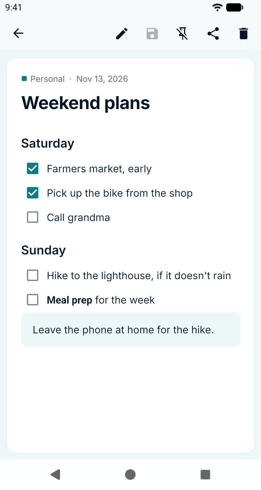
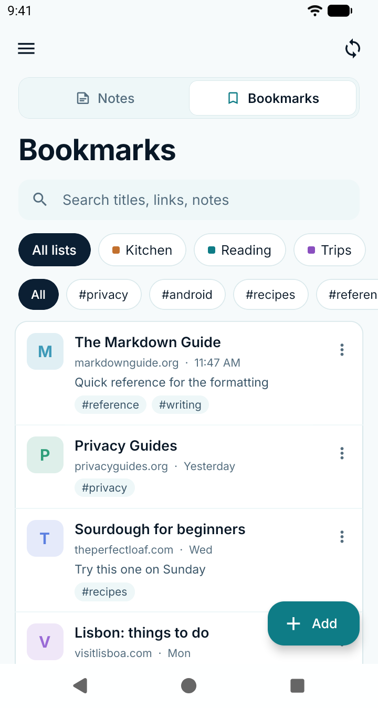
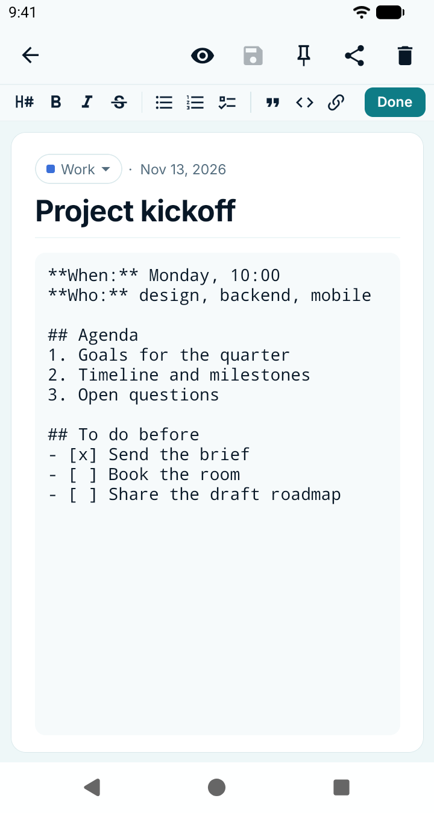
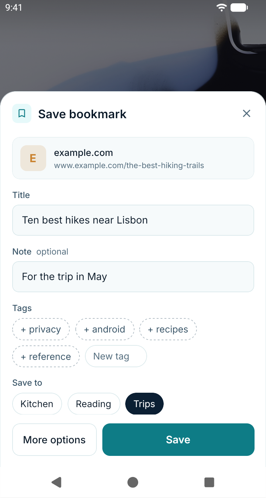
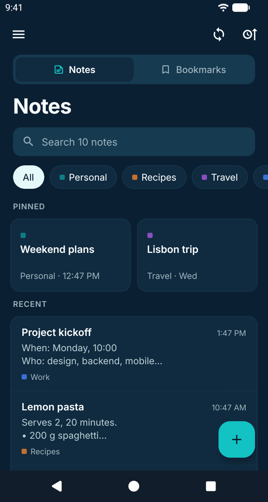

<p align="center">
  
</p>

<p align="center">
  End-to-end encrypted Markdown notes and bookmarks for Android.<br />
  Works offline. Syncs with an Etebase server you run yourself.
</p>

<p align="center">
  <a href="https://github.com/nikossvnk/ciphwren-notes/releases"><strong>Download for Android</strong></a>
  &nbsp;·&nbsp;
  <a href="https://nikossvnk.github.io/ciphwren-notes/">Explore the app</a>
  &nbsp;·&nbsp;
  <a href="#getting-started">Getting started</a>
  &nbsp;·&nbsp;
  <a href="#development">Development</a>
</p>

## A place for your notes and links

| Write and organize | Save and find | Keep control |
| --- | --- | --- |
| Markdown notes, notebooks, pinned notes, and search. | Bookmarks with lists and tags, saved from other apps' share menus. | End-to-end encryption with your own Etebase server. |
| Export notes to a ZIP and import them again. | Tracking parameters such as `utm_source` and `fbclid` are removed from saved links. | Work offline; sync while the app is open. |

<details>
<summary>Explore the app — full-size screenshots</summary>

Select an image to view it at full size.

| Notes | Markdown | Bookmarks |
| :---: | :---: | :---: |
| [](fastlane/metadata/android/en-US/images/phoneScreenshots/1-notes.png) | [](fastlane/metadata/android/en-US/images/phoneScreenshots/2-note.png) | [](fastlane/metadata/android/en-US/images/phoneScreenshots/4-bookmarks.png) |

| Editor | Save a link | Dark mode |
| :---: | :---: | :---: |
| [](fastlane/metadata/android/en-US/images/phoneScreenshots/3-editor.png) | [](fastlane/metadata/android/en-US/images/phoneScreenshots/5-save-a-link.png) | [](fastlane/metadata/android/en-US/images/phoneScreenshots/6-dark-mode.png) |

</details>

## Getting started

Ciphwren Notes needs an account on an [Etebase server](https://github.com/etesync/server) that you run yourself.

1. Download an APK from the [releases page](https://github.com/nikossvnk/ciphwren-notes/releases).
2. Install it on your Android device. On the login screen, open **Advanced settings**, enter your **Server URL**, and sign in with your username and password.
3. Create a note or save a link from another app's share menu. Keep the app open to sync your changes.

| Your device | APK |
| --- | --- |
| 64-bit Android phones (nearly all devices) | `ciphwren-notes-X.Y.Z.apk` |
| Older 32-bit Android phones | `ciphwren-notes-X.Y.Z-armeabi-v7a.apk` |

Each APK has a corresponding `.sha256` file in the release.

### Moving from EteSync Notes

Ciphwren Notes uses `com.ciphwren.notes`, a separate app ID from EteSync Notes (`com.etesync.notes`). It installs alongside the old app rather than updating it.

Sync the old app first, install Ciphwren Notes, and sign in. Check that your notes have synced before uninstalling the old app.

## Development

Built with [Expo](https://expo.dev) and React Native. Install **Node.js 24**, **JDK 17**, and the **Android SDK**, and set `ANDROID_HOME`.

```sh
npm install
npx tsc --noEmit
npm run lint
npm run android
```

CI checks Expo dependency versions, TypeScript, and lint, and runs browser tests. `npm run android` builds, installs, and starts the app on a device or emulator.

### Presentation website

The [GitHub Pages site](https://nikossvnk.github.io/ciphwren-notes/) is a static
presentation of the Android app, not the app's web build or a hosted notes service.
Its HTML and responsive CSS live in [`site`](site); it has no runtime JavaScript,
analytics, remote fonts, or build dependencies beyond Node.js.

Preview it locally:

```sh
node scripts/build-site.mjs
python3 -m http.server 4178 --directory _site
```

Open `http://localhost:4178`. The build copies the existing vector logo, README
banner, and selected store screenshots into ignored `_site/`; edit the original
assets rather than the generated copies.

The **Presentation site** workflow builds pull requests and deploys changes on
`master` to GitHub Pages. Repository **Settings → Pages → Source** must be
**GitHub Actions** (enabled for this repository). The workflow can also be run
manually on `master`. Deployment is restricted to `nikossvnk/ciphwren-notes`;
forks only build. No app code, account data, or APK build is published by it.


<details>
<summary>Release builds and browser tests</summary>

Build a release APK:

```sh
cd android
./gradlew assembleRelease
```

Without a release key, this build uses the debug key and is for testing only. See [`android/app/build.gradle`](android/app/build.gradle) for signing configuration. Published releases are built by the release workflow when a `vX.Y.Z` tag is pushed.

The app also builds for the web:

```sh
npx expo export --platform web
```

The web build is used only for the browser tests. See the [end-to-end test guide](e2e/README.md).

</details>

## Origins and license

Ciphwren Notes is an **independent fork** of [EteSync Notes](https://github.com/etesync/etesync-notes), originally created by the EteSync authors. It is not affiliated with, endorsed by, or supported by EteSync.

The original project's history and authorship are preserved, followed by this fork's changes. Like the original, Ciphwren Notes is licensed under [GPL-3.0](LICENSES/GPL-3.0-only).
